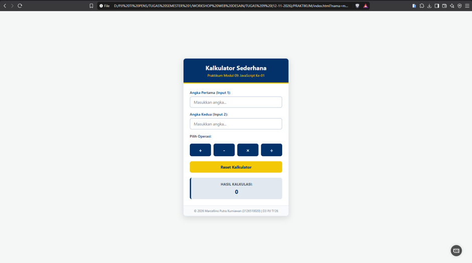

# Kalkulator Sederhana | JavaScript Basics & DOM Manipulation

Sebuah proyek halaman web _Kalkulator Sederhana_ interaktif yang dikembangkan sebagai tugas praktikum **Modul 09: JavaScript ke-01** pada mata kuliah **Workshop Desain Web**. Proyek ini mendemonstrasikan berbagai cara penyisipan skrip JavaScript (internal di `<head>`, internal di `<body>`, dan eksternal) serta teknik pengolahan masukan numerik, penanganan _events_, dan validasi pengondisian logika.

---

## 🚀 Fitur Utama & Kriteria JavaScript

- **Struktur Penulisan Skrip Fleksibel:** Mendemonstrasikan pendeklarasian fungsi kalkulasi di dalam tag `<head>` (JavaScript Internal) serta penanganan _event listener_ tombol reset pada akhir `<body>` (DOM Manipulation).
- **Operasi Aritmetika Lengkap:** Mendukung 4 operasi matematika dasar:
  - Penjumlahan (`+`)
  - Pengurangan (`-`)
  - Perkalian (`×`)
  - Pembagian (`÷`)
- **Validasi Input & Pengondisian:** Memeriksa keabsahan bidang input agar tidak kosong serta menangani kondisi khusus eror pembagian dengan angka nol ($0$).
- **Fungsi Reset Instant:** Menyeragamkan pembersihan seluruh bidang input dan hasil ke status awal dalam satu klik.
- **Desain Modern & Identitas Warna Kampus:** Antarmuka responsif yang dikemas dalam bentuk kartu (_card_) berestetika bersih dengan paduan warna identitas kampus `#023269` (Biru Utama) dan `#f3c907` (Kuning Emas).

---

## 🛠️ Teknologi yang Digunakan

- **HTML5** (Struktur Form & Input Fields)
- **CSS3** (Flexbox Centering, Responsive Card Design, & Custom Color Variables)
- **JavaScript ES6** (Functions, Event Listeners, Switch-Case Conditionals, DOM Manipulation)

---

## 📂 Komponen Antarmuka yang Disediakan

1. **Header Kalkulator:** Judul proyek dan rincian modul praktikum.
2. **Dua Field Input Angka:** Wadah untuk memasukkan nilai numerik pertama dan kedua.
3. **Grid Tombol Operasi:** 4 tombol aksi cepat (`+`, `-`, `×`, `÷`) dengan efek transisi interaktif.
4. **Tombol Reset:** Pintasan untuk membersihkan input dan nilai hasil secara instan.
5. **Box Display Hasil:** Area penampil output hasil kalkulasi secara terstruktur.

---

## 📸 Tangkapan Layar (Pratinjau Tampilan)

### Tampilan

---

## 👨‍💻 Penulis

**Marcellino Putra Kurniawan**

- **NRP:** 3126510020
- **Program Studi:** D3 PJJ Teknik Informatika '26
- **Institusi:** Politeknik Elektronika Negeri Surabaya

---

_Dibuat untuk memenuhi Tugas Praktikum 9 Workshop Desain Web (Semester 1)._
